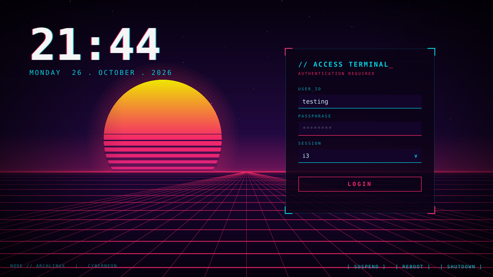
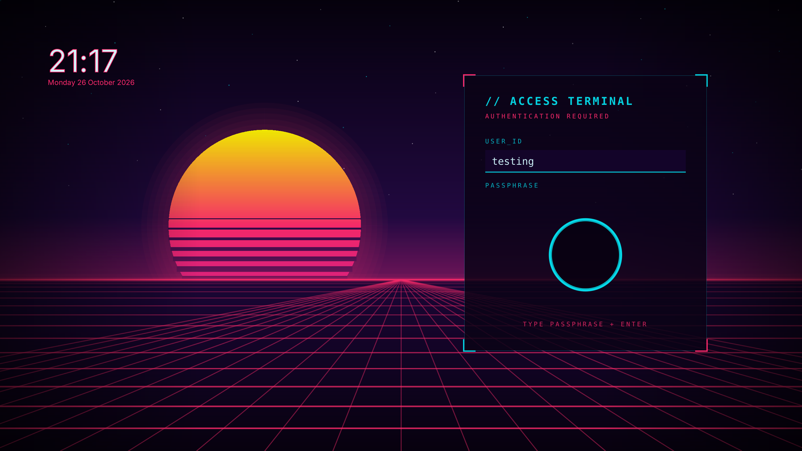
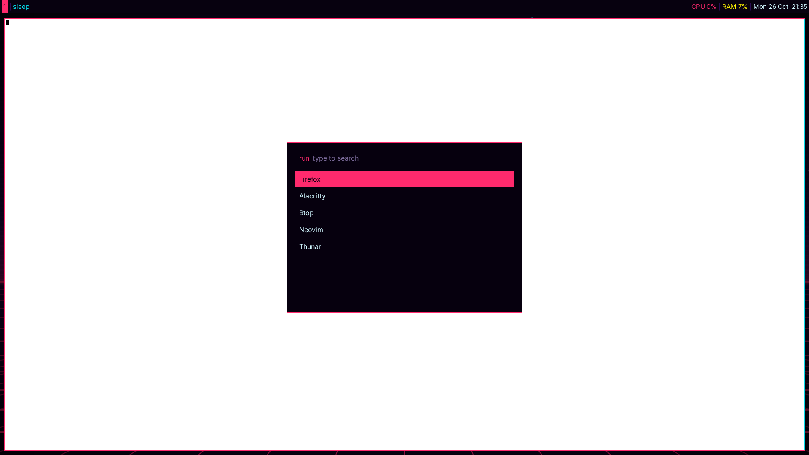
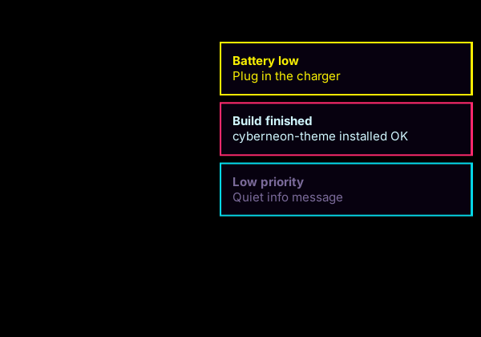

# Cyber Neon

A synthwave / cyberpunk desktop theme for **Arch Linux + i3**: one palette applied to the login screen, lock screen, wallpaper, window borders, bar, launcher, notifications and terminal.

| Login (SDDM) | Lock (i3lock-color) |
|---|---|
|  |  |

| i3 + polybar + rofi | Notifications (dunst) |
|---|---|
|  |  |

Palette: pink `#ff2a6d`, cyan `#05d9e8`, yellow `#f9f002`, text `#d1f7ff`, background `#07010f`. Font: JetBrainsMono Nerd Font.

## What is in here

| Folder | What | Needs |
|---|---|---|
| `sddm/cyberneon` | SDDM login theme (Qt6, no shaders, works with software rendering) | `sddm`, `ttf-jetbrains-mono-nerd` |
| `lock/` | i3 lock screen: baked scene + live clock and unlock ring | `i3lock-color` (AUR), `imagemagick`, `xorg-xrandr` |
| `desktop/` | Wallpaper, i3 colours/gaps, polybar, rofi, dunst, kitty/alacritty colours, all generated from `palette.sh` | `feh`, `polybar`, `rofi`, `dunst`, `imagemagick` |
| `tools/harness.py` | Renders the SDDM theme offscreen with mocked SDDM objects (for previews) | `pyside6` |

## Install

### Desktop theme (i3 look, polybar, rofi, dunst, terminal)
```sh
sudo pacman -S feh polybar rofi dunst imagemagick ttf-jetbrains-mono-nerd
bash desktop/install.sh
```
Backs up your i3, polybar, rofi, dunst and kitty files (`*.bak-<timestamp>`), adds one `include` line at the end of your i3 config, then restart i3 (`$mod+Shift+r`). Comment out any old `feh` wallpaper line yourself. Alacritty users must add the printed `import` lines manually.

To change colours: edit `~/.config/cyberneon/palette.sh`, run `~/.config/cyberneon/apply.sh`, reload i3.

If notifications stay grey, another daemon (e.g. `xfce4-notifyd`) owns them: `pkill xfce4-notifyd; dunst &`.

### Lock screen
```sh
yay -S i3lock-color
sudo pacman -S imagemagick
mkdir -p ~/.config/i3 && cp -r lock/lock.sh lock/cyberneon-lock ~/.config/i3/
chmod +x ~/.config/i3/lock.sh
timeout 30 ~/.config/i3/lock.sh --nofork     # safe test, unlocks itself after 30 s
```
Then bind it, e.g. `bindsym $mod+Shift+x exec ~/.config/i3/lock.sh`. After 3 wrong passwords `pam_faillock` locks you out; reset with `faillock --user $USER --reset`.

Limits (X11 lockers can only show a still image): the typed password shows as a ring, not in a text field, and the grid does not animate. The "USER_ID" shown in `lock/cyberneon-lock/panel.png` is baked in as `testing`; re-render it for your own username (see below).

### SDDM login theme
```sh
sudo cp -r sddm/cyberneon /usr/share/sddm/themes/
echo -e "[Theme]\nCurrent=cyberneon" | sudo tee /etc/sddm.conf.d/theme.conf
sddm-greeter-qt6 --test-mode --theme /usr/share/sddm/themes/cyberneon   # preview
sudo systemctl enable sddm
```
`metadata.desktop` must contain `QtVersion=6` (exact case) or SDDM falls back to the Qt5 greeter and shows a black screen.

## Re-rendering the lock image
`Main.qml` has a `lockmode` config flag (`panel` or `bg`) that hides the live parts and freezes the animation:
```sh
python -m venv v && v/bin/pip install pyside6
LOCKMODE=panel v/bin/python tools/harness.py sddm/cyberneon lock/cyberneon-lock/panel.png 2560 1440
LOCKMODE=bg    v/bin/python tools/harness.py sddm/cyberneon desktop/wallpaper.png 2560 1440
```
Change the user shown in the panel by editing `lastUser` in `tools/harness.py`.

## Undo
Restore the `*.bak-*` files, remove the `include .../i3-cyberneon.conf` line from your i3 config, and set another SDDM theme.

## Status
Tested in a virtual display and on one Arch VM (VirtualBox, i3). Not tested on other setups.

## 🤖 Built with AI & Author's Learning Journey

> [!NOTE]
> **Disclaimer:** This project was 100% built using AI (pair-programmed with an advanced AI coding agent).
> It was created as a hands-on learning exploration for the author to understand how a themed Linux desktop (Arch Linux, i3, SDDM with Qt/QML, polybar, rofi, dunst and i3lock-color) can be designed, built, debugged and refined end-to-end through AI-driven software engineering.

## License
MIT, see `LICENSE`.
